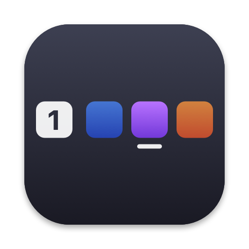

# Panbar

A macOS menu bar companion for [Paneru](https://github.com/karinushka/paneru),
the sliding, tiling window manager.


Paneru lays windows out on a strip that scrolls past the edges of the screen,
which makes it easy to lose track of what's open. Panbar shows:

- **The current Desktop's number**, styled like the macOS Spaces indicator.
- **An icon for every window on that Desktop, in Paneru's strip order.** The
  focused window is underlined, and windows scrolled off-screen are dimmed.

Click the item for a list of the windows with their titles.

On Macs with a notch, Panbar only grows into the free space next to it. When
there are more windows than fit, it shows the ones around the focused window
and counts the rest (`+3`) at either end.

## Requirements

- macOS 14 or later
- Paneru 0.4.2 or later, running. Panbar is developed against 0.5.2.

## Install

### From a release

1. Download `Panbar-<version>.zip` from
   [Releases](https://github.com/systemicdream/Panbar/releases) and move
   `Panbar.app` to your Applications folder.
2. Open it. Panbar isn't notarized, so macOS blocks it the first time: go to
   **System Settings → Privacy & Security** and click **Open Anyway**.

### From source

Building needs Xcode 16 or later.

```sh
git clone https://github.com/systemicdream/Panbar.git
cd Panbar
./scripts/bundle.sh --install
```

This builds `Panbar.app`, copies it to `~/Applications` and launches it.

### Launch at login

Choose **Launch at Login** from Panbar's menu.

## Notes

- **Ice, Bartender and other menu bar managers** may put Panbar in their
  hidden section when it first appears. Drag it out to keep it visible.
- **A ⚠ icon** means Panbar can't reach Paneru; hover over it for the error.
  Panbar reconnects on its own once Paneru is running.
- **Panbar finds `paneru`** in `/opt/homebrew/bin`, `/usr/local/bin`,
  `~/.cargo/bin` or your `PATH`. To use a different binary, set
  `PANBAR_PANERU_PATH`.
- **Desktop numbers** come from a private macOS API
  (`CGSCopyManagedDisplaySpaces`), the same one yabai uses, because Paneru
  reports internal Space IDs rather than the numbers Mission Control shows.
- **Paneru's virtual workspaces** (several rows on one Desktop) aren't shown
  separately yet.

## How it works

Panbar runs `paneru subscribe --json` and, on each event, reads the full
layout with `paneru query state --json`. Paneru lists each Desktop's windows
left to right along the strip, which is the order Panbar draws them in.

The code is a Swift package:

| Path | What it is |
| --- | --- |
| `Sources/PanbarCore` | Paneru's state models, the client and subscription, and Desktop numbering |
| `Sources/Panbar` | The menu bar app |
| `Sources/panbar-cli` | Prints the current Desktop's windows in strip order; `--all` for every Desktop |
| `scripts/bundle.sh` | Builds `Panbar.app`; `--install` to install it, `--release` for a universal zip |
| `scripts/make-icon.swift` | Regenerates `Resources/AppIcon.icns` |

Run the tests with `swift test`.

## License

[MIT](LICENSE)
